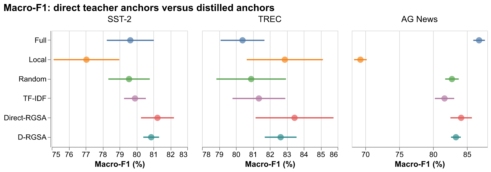

# D-RGSA: Distilling Teacher Rationales into Global Anchors

Research code for **Distilling Teacher Rationales into Global Anchors for Sparse Text Classification**, accepted at BDCIA 2026.

D-RGSA learns a lightweight token selector from teacher rationale spans. At inference time, the selector predicts global attention anchors without a teacher call for each example. Controlled comparisons use the same lightweight student with Full, Local, Random, TF-IDF, Direct-RGSA, and distilled attention patterns.



## Repository map

- `src/rgsa/`: data preparation, teacher annotation, token alignment, attention models, selector training, evaluation, and plotting.
- `scripts/`: experiment and figure-generation entry points.
- `tests/`: core and attention-model checks with small fixtures.
- `reports/`: saved experiment reports, long-text extension, and consistency audit.
- `outputs/`: selected saved metrics, tables, and figures; pretrained weights and tokenizer copies are excluded.
- [Detailed research instructions](README.research.md).
- [Long-text experiment report](reports/long_text_extension_final.md).

## Setup and tests

Use Python 3.10–3.13.

```bash
python3.12 -m venv .venv
source .venv/bin/activate
python -m pip install -e '.[dev]'
python -m pytest tests -q
```

To inspect the data and training interfaces without starting a run:

```bash
rgsa-prepare-sst2 --help
rgsa-distill-anchors --help
rgsa-train --help
```

Teacher annotation requires a separately configured API key; copy `.env.example` to `.env` locally. Annotation commands may incur provider charges. See `README.research.md` for the full experimental sequence and dataset preparation.

## Data and interpretation

Datasets include SST-2, TREC, AG News, and IMDb. Download and prepare them through the included commands, subject to their upstream terms. Raw corpora, model weights, teacher request logs, and private credentials are not redistributed here.

Logical attention sparsity measures connectivity. A dense masked implementation does not automatically yield sparse-kernel acceleration. Timing, tensor-allocation, and quality results must be interpreted within the specific saved benchmark configuration; they are not universal deployment claims.

`SOURCE_SNAPSHOT.json` records the files selected from the local research project on 2026-11-01. This repository is a curated source-and-results snapshot, not a new experiment run.
